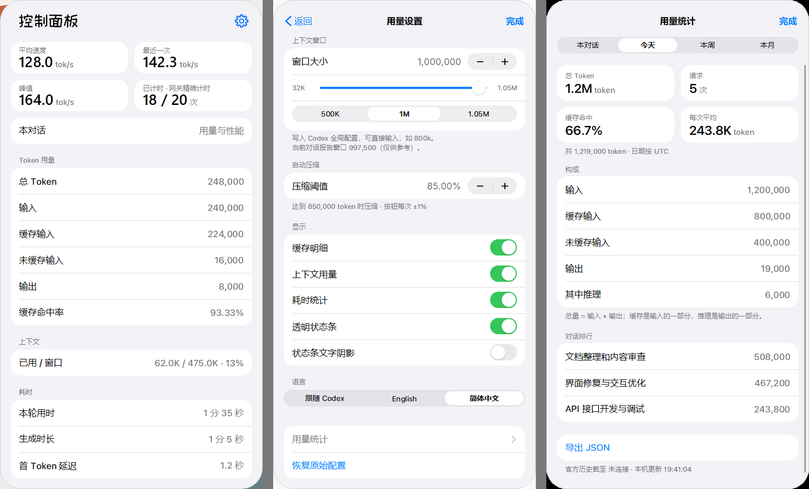
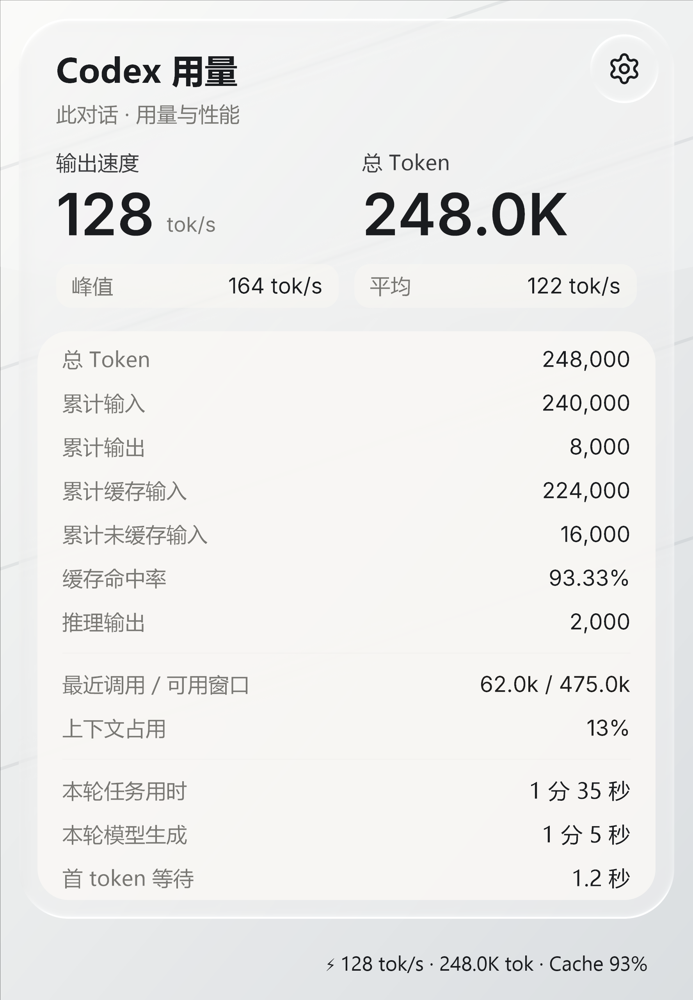
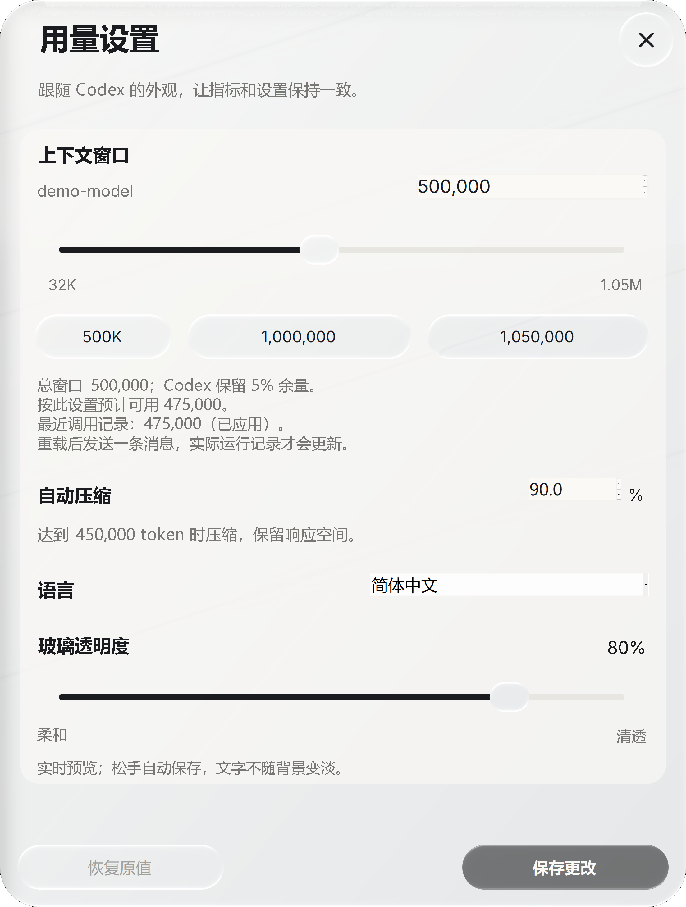
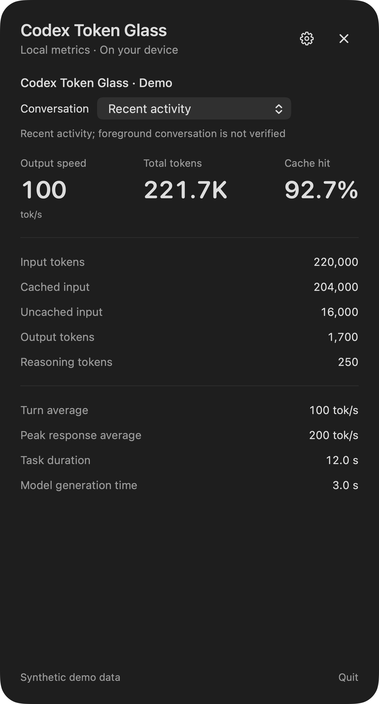
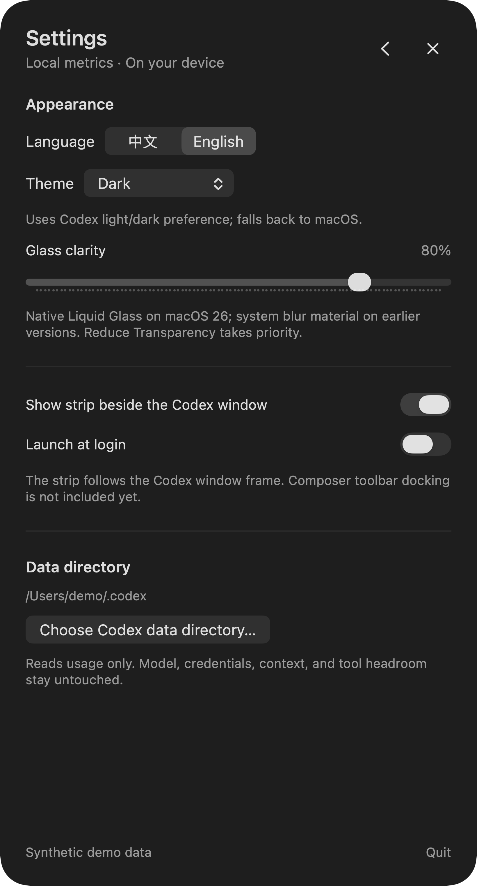

# Codex Token Glass

给 Windows 版 Codex 加一条贴附状态栏：token 用量、缓存命中率、模型输出吞吐，以及可交互的 Liquid Glass 详情和设置面板。

**这是独立的 Windows 桌面伴随程序。** 它贴附在官方 Codex 窗口上，不是 `codex plugin add` 安装的 MCP 插件，也不修改、注入或替换 Codex。

基于 [dongyue-19/codex-statusbar](https://github.com/dongyue-19/codex-statusbar) 修改，保留上游 MIT 许可及署名。图形材质使用 [LiquidGlass](https://github.com/shayann07/liquidglass)，不是 Apple 官方组件或原生 iOS API。

## 1.0 终极版



*合成数据渲染，未截取真实会话或桌面。从左到右：控制面板、用量设置、用量统计。*

- 版本号定为 `1.0.0`，取代此前的 `1.0.0-rc3-glass.N` 预览序号；功能和界面与 glass.63 相同，下面各节是到 1.0 为止的逐版更新记录。
- 三个页面同尺寸、同圆角的 iOS 风格表单：控制面板（当前模型段的速度、Token 用量、上下文、耗时）、用量设置、用量统计（按范围、模型 · 线路、日期汇总）。
- 用量按「当前连续模型 + 线路」分段统计，切换模型或线路后从新段开始计；统计页保留整个对话的总账。
- 发布包是单个自带运行时的 `CodexStatusbar.exe`：不需要另装 .NET，不需要 API key，不是 MCP 插件。需要 Windows 10/11 x64 和已安装的 Codex。

## 导航按钮回到同心（glass.62–63）

- 在 glass.61 的基础上，导航按钮的位置回到 glass.59 的做法：一级面板的齿轮以右上角圆角的圆心 (460, 40) 为中心，设置页和统计页的“完成”以同一点为中心，“返回 / 设置”在左边对称（两侧到边缘都是 23）。glass.60 的“右边缘对齐卡片边缘”撤回。
- 一级面板的速度方块回到从 80 开始、每块高 60。
- glass.62 曾在齿轮下方加“设置”两个小字，glass.63 已去掉。算法部分（glass.61）没有改动。

## 切模型/换线路分段账本与反代对账修复（glass.61）

- **当前连续模型+线路分段账**：状态条与一级面板改为按「当前连续模型 + 线路段」统计用量、缓存命中率、均速、最近一次与峰值；统计页保留整个对话总账并按「模型 · 线路」分组。切换模型或同模型换线路（如 Vertex → Devin）开启新段，A→B→A 计为三段不互相继承；刚切换未发请求前显示待开始（`—`），不再沿用旧速度或被 IPC 线程累计覆盖；早先轮次的迟到响应归回原段，不污染当前段。
- **修复混合载体漏记与串账**：`UsageLedger` 和测速引擎不再在整文件上二选一，同一文件混有旧制 `token_count` 与现代 `token_usage_record` 时既去重镜像又保留独立旧制请求；通过 `turn_id → turn_context` 映射归属模型，修复晚到响应串账和旧记录固定记 `unknown` 的问题。
- **区分未知缓存与已知 0**：缺失 `cached_input_tokens`、`cache_unknown=true` 或仅有 `state_5.sqlite` 总量时不再把未知显示成 `0%` 或污染缓存命中率分母；支持 OpenAI Chat Completions 与 Anthropic 原生用量字段归一。
- **Magpie 唯一匹配对账、ID 冲突保护与 `flow_ms` 校验**：过滤非 200 失败请求、探针与非 Codex 代理记录；同 `response_id` 出现不同计数或跨会话碰撞时标记冲突而非静默吞掉，双源分歧保留 Codex 口径绝不相加；网关测速增加 `flow_ms` 交叉检查过滤尾延迟冲刷样本。

## 导航按钮按边距对齐（glass.60）

- 导航栏按钮没有背景，改按平台惯例用边缘对齐布局边距（这里就是卡片边缘，距面板 20），不再以圆角圆心为中心：一级面板的齿轮、设置页和统计页的“完成”，右边缘都落在卡片右边缘上；“返回 / 设置”的箭头从卡片左边缘开始。三页的按钮仍在同一条中线（40）上，切换页面时右边缘不动。
- 一级面板的速度方块从 72 开始（齿轮下方约一个边距），高度从 60 加到 64。

## 对话名单独成格、三页右上角按钮同一圆心（glass.59，按钮位置已被 glass.60 取代）

- 一级面板的对话名有了自己的格子：速度方块下方 12 处的一整行白色卡片，左边“本对话”，右边是对话名，写法和其他行一样。方块下方的两行脚注取消，计时来源回到第四个方块的标题（“已计时 · 网关精确计时”）；速度方块高度改为 60。
- 三个页面右上角的按钮现在是同一个圆心：一级面板的齿轮、设置页和统计页的“完成”，中心都落在右上角圆角的圆心 (460, 40) 上，切换页面时不会错位；都没有背景。“完成”因此比原来右移 13，左上角的“返回 / 设置”对称地左移 6，两侧到边缘的距离相同（23）。

## 一级面板：去掉按钮圆底、对话名移到方块下方（glass.58，脚注已被 glass.59 取代）

- 设置按钮去掉 glass.57 的白色圆底，只留齿轮，放大到 26 DIP。齿轮中心仍是面板右上角圆角的圆心，所以与圆角同心：距上边 27、距右边 27；速度方块从 80 开始，距齿轮下沿也是 27。
- 标题“控制面板”单独一行在左侧（站酷快乐体 31 px），字形高 26，与齿轮同高、同一条中线。
- 对话名不再放在标题下面，改成速度方块下方脚注的第一行“本对话：……”（与统计页方块下的写法相同），第二行是测速公式和计时来源；两行脚注的位置与设置页的两行脚注相同。方块高度回到 74。

## 一级面板：同心的设置按钮、左侧标题（glass.57，圆底和标题下的对话名已被 glass.58 取代）

- 一条规则管住一级面板上所有白色形状：距面板边缘 20，圆角半径等于面板圆角 40 减去这 20。设置按钮就是这条规则用在右上角：直径 40 的白色圆形按钮，圆心就是面板右上角圆角的圆心，所以与圆角同心，距上边和右边都是 20，右边缘就是下面卡片的右边缘。里面是 24 DIP 的蓝色齿轮；悬停、按下的反馈与卡片里的可点行相同。
- 二级页左右各有一个按钮，标题居中；一级面板只有右侧一个按钮，标题改放左侧（文字边距 36）与它呼应：“控制面板”用漫画风的站酷快乐体（28 px），下面一行灰色小字是对话名，两行合起来与按钮同高（20–60）。站酷快乐体随程序打包，SIL OFL 1.1，见 `assets/fonts/LICENSE-ZCOOLKuaiLe.txt`。
- 速度方块上方不再有分区标题，方块从 72 开始，与按钮之间是和方块之间相同的 12 间隔；方块加高到 84。
- 三页的导航行中线回到 40（就是圆角圆心所在的那条线），设置页、统计页恢复到 glass.55 的位置，面板高度回到 932。

## 一级面板改名“控制面板”、顶部间距统一（glass.56，顶部布局已被 glass.57 取代）

- 一级面板标题从“用量”改为“控制面板”（英文 “Control Panel”），字体和字号与设置页、统计页的标题相同（17 pt 半粗，居中）。glass.55 试过漫画风的站酷快乐体大标题，已撤回，字体不再打包。
- 三个页面的顶部一起上移，间距统一为：顶边到标题字形 24，标题到第一个分区标题 24，分区标题到卡片 9，和下面各组“卡片到分区标题约 25、分区标题到卡片 9”的节奏一致。导航行中线从 40 改为 32，第一张卡片从 92 改为 85；三页高度从 932 改为 925，底部留白仍是 20。
- 设置齿轮为 26 DIP（22 嫌小，28 嫌大），右边缘落在 36 的文字边距上，与下面数值列的右边缘、设置页“完成”的右边缘是同一条线，中线也相同。

## 一级面板标题与分段控件（glass.54，标题已被 glass.55 取代）

- 一级面板的标题改成和设置页、统计页完全一样的导航标题：17 pt 半粗、水平居中、中线 40。glass.53 放在左侧的 34 pt 大标题与右侧 22 DIP 的齿轮一大一小，看起来没有对齐，已取消。
- 设置页“语言”分段控件不再套一层白色卡片，直接以卡片宽度放在页面上，与统计页顶部的范围切换是同一个样式。原先胶囊在单行卡片里两端留 16、上下只留 9，和卡片圆角不同心。
- 设置页“窗口大小”卡片最后一行的预设分段控件，距卡片底边从 9 改为 16，与左右两侧相同。
- 直接放在页面上的分段控件轨道改用更深的 `ControlFill`（iOS 的半透明灰叠在灰色页面上本来就比叠在白卡片上深），统计页的范围切换同步修改，未选中项不再像浮在背景上。

## 一级面板与设置页共用骨架（glass.53，标题样式已被 glass.54 取代）

- 一级面板改用设置页、统计页的同一副骨架，推入二级页时没有元素跳动：导航行中线在 40，第一个分区标题字形在 71–82，第一张卡片从 92 开始，卡片左右 20，文字左右 36，行高 50，底部 20。
- 设置按钮回到导航行，位置与设置页的“完成”完全一致（右边缘 36，中线 40）。去掉 glass.52 的圆底，改为 22 DIP 蓝色齿轮，描边与“完成”、返回箭头同级；悬停、按下的反馈与导航文字按钮相同。
- 大标题“用量”（34 pt 粗体）放在导航行左侧，左边缘落在 36 的文字边距，与分区标题、行标签同一条线。对话名恢复为速度方块上方的分区标题。
- 速度方块作为首页主视觉：高 74，数字 28 pt。第四块标题只写“已计时”，来源说明移到方块下方的脚注“速度 = 输出 Token ÷ 生成时长 · 网关精确计时”，脚注和下一组的间距与设置页卡片脚注一致。
- 分区标题的字形底到卡片的距离从 7 改为 9，与设置页一致。

## 一级面板标题行、圆形设置按钮与清晰分隔线（glass.52，顶部布局已被 glass.53 取代）

- 一级面板顶部改为“眉题 + 大标题 + 标题行按钮”：对话名是大标题上方的 13 px 灰色眉题，与“用量”同一左边缘（卡片边 20）；设置按钮移到大标题同一行，垂直居中于标题字形，右边缘同样落在卡片边 20，左右对称。原先只放一个齿轮的顶部空带取消。
- 设置按钮从 18 DIP 细描边齿轮改为 36 DIP 圆形按钮，内含 22 DIP 齿轮；描边加粗到与返回箭头、“完成”同级，按设备像素直接栅格化，不再缩放发虚。悬停和按下状态体现在圆底上，点击区域仍是 44 DIP。
- 面板行高从 48 改为 50，与设置页、统计页一致；默认十行时底部留白为 20，最后一张卡片的圆角与面板圆角同心。
- 一级面板和统计页的分隔线改为填充的 1 px 实线（原先 1 px 画笔跨两行像素，显示为 2 px 淡痕，并越出卡片右边缘 1 px），颜色、粗细与设置页一致。
- 文案统一：“首 token 延迟”改为“首 Token 延迟”；上下文行的千位后缀从 `k` 改为 `K`（如 `59.1K / 997.5K · 6%`），与状态条、统计页、设置页一致。

## iOS 根页面大标题、等分方块与隐藏状态条修复（glass.51）

- 一级面板是导航栈的根页面，改用 iOS 根页面样式：34 pt 粗体大标题“用量”靠左，与卡片边缘对齐，齿轮留在其上方的导航栏。设置、统计是推入的子页面，保留 17 pt 居中小标题。
- 速度区改为 iOS 18 天气、健身同款的 2 × 2 等大方块：平均速度 / 最近一次 / 峰值 / 已计时，每块都是“小标题 + 数字 + 单位”，没有谁独占空间。统计页顶部同样改为 2 × 2：总 Token / 请求 / 缓存命中 / 每次平均。面板行高 48，底部留白 36。
- 深色文字的覆盖率加轻微 gamma（0.78，相当于 DirectWrite 的增强对比度），修复 SF Pro 这类无 hinting 的 CFF 字体在 96 DPI 下笔画发细的问题。
- 修复崩溃：Codex 窗口最小化或被遮挡时，状态条从未显示，窗口句柄不存在，此时从托盘或本地命令打开设置会抛出 “Invoke or BeginInvoke cannot be called…”。现在会改用已创建的窗口投递；状态条不可见时，二级页面在屏幕居中打开，不再跑到左上角 (0, 0)。

## 一级面板留白、三等分格与标题（glass.49–50）

- 速度卡片下层改为三格，每格正好是卡片宽度的 1/3，格间加竖线（参考 Apple 地图地点卡片）；分隔横线左右缩进相同的 16 px；卡片加高到 162，上下留白相等。统计页顶部卡片用同一结构：请求 / 缓存命中 / 每次平均。
- 一级面板底部留白从 20 加大到 40，与标题中线距顶部的 40 对称。
- 导航标题统一为短词：一级面板“用量”，二级“用量设置”“用量统计”；对话名改为速度卡片上方的分区标题，数据来源（网关精确计时）写在“平均速度”后面。
- “已用 / 窗口”与“上下文占用”合并为一行（如 `476.3k / 997.5k · 48%`），面板布局按实际绘制的行数计算。
- 齿轮缩小为 18 DIP：描边齿轮的视觉尺寸比同字号文字大，18 DIP 看起来与 17 pt 标题等重。

## 速度卡片改为两层对称结构与标签审计（glass.48）

- 速度卡片改为 iOS 摘要卡的两层结构：上层是通栏的平均速度；分隔线下是“最近 / 峰值 / 已计时”三等分列。原来卡片外的“已计时”脚注并入第三列。每层的标签共用一条基线，数字共用一条基线，卡片上下留白相等（实测 15 / 14 px）。
- 行标签去掉冗余：“累计输入/输出/缓存输入/未缓存输入”改为“输入/输出/缓存输入/未缓存输入”（面板内本来都是累计值）；“最近调用 / 可用窗口”改为“已用 / 窗口”；“本轮任务用时”改为“本轮用时”；“已计时生成时长”改为“生成时长”；“首 token 等待”改为“首 token 延迟”。
- Token 行按逻辑排序：总 Token → 输入 → 缓存输入 → 未缓存输入（两者都是输入的组成部分）→ 输出 → 缓存命中率，与统计页的“构成”顺序一致。

## 速度卡片对齐与本机 SF Pro（glass.47）

- 速度卡片按 iOS 摘要卡排版：平均速度作为主数字靠左，“最近 / 峰值”整组右对齐到右侧内容边距；三个标签共用一条基线，三个数字共用一条基线；速度统一千分位加一位小数（如 `1,337.0`）。
- 新增 `AppleText.BaselineOffset`，不同字号可以精确落在同一条基线上。
- 齿轮按 iOS 导航栏图标尺寸调整为 21 DIP，与右侧“完成”的右端对齐。
- 本机 `%LOCALAPPDATA%\CodexStatusbar\fonts` 里如果有 SF Pro（`SF-Pro-Text-*.otf`、`SF-Pro-Display-*.otf`），会优先使用：20 pt 以下用 Text，20 pt 及以上用 Display，与 iOS 一致；没有时回退内置的 Inter。SF Pro 仅供本机使用，不随程序或仓库分发。

## iOS 导航栈、统一圆角与内置字体（glass.46）

- 三级页面按 iOS 18 导航栈组织：一级面板 → 设置 → 用量统计。设置页左上角“‹ 返回”回到一级面板，统计页“‹ 设置”回到设置；右上角“完成”收起整个导航栈；Esc 退回上一级。像 iOS 设置一样，离开设置页即应用修改。从托盘直接打开统计时，也会先进入设置页，返回链路完整。
- 修复设置页卡片偏移半个像素：GDI+ 默认像素偏移使同尺寸贴图模糊一圈，导致圆角看起来比一级面板和统计页小。现在所有卡片和文字栅格都按像素原样贴图，三页卡片实测圆角都是 20 px，边缘清晰。
- 右上角齿轮改为 iOS 18 导航栏样式：SF Symbols `gearshape` 描边、8 齿、系统蓝、无底色，悬停或按下时变淡；右边缘对齐 36 DIP 内容边距，与设置页“完成”的右端一致。
- 字体全部内置，安装后无需另装：Inter 4.1 Regular/SemiBold/Bold，Noto Sans SC Regular/Medium/Bold，均为 SIL OFL 授权。低分屏优先使用系统自带、hinting 更好的微软雅黑 UI。中文没有 Semibold 字重，因此中英混排的半粗标题统一为 Bold，同一行不再一半粗一半细。
- 苹果的 SF Pro 和苹方没有内置：苹果授权只允许在苹果平台上用于界面设计稿，禁止再分发，也禁止在其他系统上使用。

## 一级面板、设置与统计统一为同一张 iOS 表单（glass.45）

- 一级面板、设置页、统计页统一为 500 × 932、外圆角 40、卡片圆角 20、行高 50，且在屏幕上完全重合打开；`--self-test` 检查设置页尺寸与一级面板一致。屏幕放不下时一级面板压缩行高，统计页可滚动。
- 一级面板改为设置页同款结构：居中 17 px 标题 + 右上齿轮；“响应速度”大卡片（平均速度为主，最近 / 峰值为副列）；Token 用量、上下文、耗时三组分区标题 + 卡片。去掉“统计”按钮、API 价格卡和齿轮的 Windows 提示框。
- 设置页“详情面板”“状态条”两组开关合并为“显示”；底部新增“用量统计 ›”入口，与“恢复原始配置”同组，总高度不变。
- 统计页重做为 iOS 二级页：“‹ 设置”返回（从托盘打开时为“完成”），本对话 / 今天 / 本周 / 本月分段；总 Token、请求数、缓存命中率，输入 / 缓存 / 未缓存 / 输出 / 推理构成，以及按模型、按日期、对话排行明细；全部去掉价格，导出 JSON 也不再包含价格。

## 低分屏中文清晰度（glass.44）

- 低于 144 DPI（如 1080p/100% 缩放）时，中文改用带手工 hinting 的微软雅黑 UI，并按整像素定位字形；Noto Sans SC 是无屏幕 hinting 的 CFF 字体，在 13–17 px 下笔画会落在两个像素之间而发虚。高分屏仍优先 Noto Sans SC（更接近苹方），未安装时回退雅黑 UI。
- 英文版 Windows 可能带有 `msyh.ttc` 却未注册，系统会把中文回退到日文 Yu Gothic；现在直接加载该字体文件，并在 `--self-test` 中检查中文永不落到 Yu Gothic。
- 文字阴影与正文走同一 Skia 渲染管线，字形一致。
- 新增 `--font-probe <dir>`：输出低/高密度实际渲染与原生 ClearType 对照图和字体选择结果。

## 加宽面板与开关对齐（glass.43）

- 一级面板和设置页同步加宽到 500；设置页行高恢复为 50，分区间距恢复，控件高度与比例不变（分段控件、步进器 32，开关 51×31）。
- 面板关闭时打开设置的回退宽度改为引用面板宽度常量，两级菜单不再因硬编码宽度错开。
- iOS 开关改为单一 Skia 位图绘制（轨道、柔和投影、白色滑块），滑块与轨道上、下、侧边间隙实测均为 2 px。

## 设置页光学居中与压缩高度（glass.42）

- 单行文字改为按实际字形墨迹居中：拉丁字母和数字以字顶到基线居中（逗号等下伸部分不影响），中文以字形上下边界居中；实拍逐行测量，标签与行中心偏差不超过 0.5 px。
- 数值输入框下移 2 px，与左侧标签对齐；“取消”与“完成”使用同一字重。
- 设置页行高 46、分区间距收紧，总高度从 952 降到 872。
- 面板关闭时打开设置，按状态条中心定位，与一级面板左边缘重合。

## 更大的同心圆角与统一尺度（glass.41）

- 外框圆角 40，卡片与按钮行圆角 20，边距 20，满足 20 + 20 = 40；一级面板齿轮按钮的圆心落在圆角半径上。
- 设置页行高 50；导航栏“取消 / 完成”与列表文字左右对齐，悬停改为文字变淡，不再出现贴边的灰色底。
- 单行文字按字形高度垂直居中（不再计入行距），分段控件、按钮文字都落在正中。
- 一级面板与设置页同一尺度：正文 17 px、行高 40、标题 20 px、主数字 34 px。

## iOS 开关、可输入数值与取消/完成导航（glass.40）

- 设置页导航栏改为 iOS 的“取消 / 完成”：完成时才写入上下文配置，取消或 Esc 不保存；“恢复原始配置”改为独立的按钮行。
- 上下文窗口和压缩阈值可直接输入：窗口支持 `800k`、`1.05m` 写法；阈值保留两位小数，步进器每次 ±1%。
- 新增 iOS 开关（系统绿 `#34C759`）：详情面板的缓存明细、上下文用量、耗时统计分组，以及状态条的透明背景、文字阴影，切换即时生效。
- 一级面板和设置页加宽到 460，边距统一为 20，卡片圆角 12（12 + 20 = 外圆角 32）；面板行高 32、正文 15 px；“统计”和齿轮改为 iOS 导航栏的无底色蓝色按钮。
- 新增本地控制命令 `--control-panel`、`--control-settings`、`--control-stats` 及对应关闭命令，配合 `tools/capture_live.ps1` 截取真实界面用于自检。

## 胶囊按钮、同心圆角与 ClearType 字体（glass.39）

- 文字改为 ClearType 子像素渲染，并按真实底色逐通道混合；拉丁字母和数字用 Inter（最接近 SF Pro 的开源字体），中文回退到 Noto Sans SC。
- 所有按钮、步进器、分段控件改为胶囊形（矩形加两个半圆）；圆角统一为圆弧，贴角元素满足“外圆角 = 内圆角 + 边距”。
- 设置页按 iOS 设置样式：居中 17 px 标题、30 px 圆形关闭按钮、44 px 行高、17 px 正文、13 px 分区标题和说明；强调色用 iOS 系统蓝 `#007AFF`。
- 一级面板改为 iOS 的 value1 行样式：左侧标签用主文字色，右侧数值用次要色。

## iOS 18 分组列表重构（glass.38）

- 统一为 iOS 系统色：浅色 `#F2F2F7` 分组底 + 白色单元格，深色 `#1C1C1E`/`#2C2C2E`；单一强调蓝，去掉卡片描边与投影，正文与次要文字对比度不低于 4.5:1。
- 设置页改为 Inset Grouped 结构：分区标题、分组卡片、灰色说明；原生上下箭头输入框与下拉框换成 iOS 步进器和分段控件；删除已无作用的“界面层次”滑块；百分比改为行内数值 + 步进器。
- 设置页在一级面板的同一位置、同一宽度打开，两级菜单不再错位。
- 一级面板：统计与设置按钮统一为灰底蓝色的 bordered 样式；详情拆为三个分组卡片并加行分隔线；无价格时显示 `—`。

## iOS 18 连续曲率大 R 角、SkiaSharp 矢量字体与设置键重构（glass.36）

- 彻底消除中文 `.otf` 字体在 Windows GDI+ 下的像素锯齿感：`AppleText` 改由 SkiaSharp/DirectWrite 统一渲染所有字体并自动中英混排回退，标题与 Hero 大数字采用 iOS 18 标准 `Bold (700)` 字重。
- 对齐 Apple 官方 HIG 大 R 角与同心圆角（`R_outer = R_inner + padding`）：外框恢复 32–36 DIP 连续曲率超椭圆（Squircle），内嵌分组卡片严格同心 16–20 DIP，独立胶囊按钮使用标准全圆角胶囊；设置窗口启用 `SoftWindowEdge` 32-bit ARGB 抗锯齿外环，彻底消除 WinForms 1-bit 裁边锯齿。
- 设置图标升级为 iOS 18 SF Symbols `gearshape.fill` 饱满实心齿轮；修复 `glass.34` 中 `FlatAppearance.BorderColor = Color.Transparent` 导致的设置窗体崩溃并纳入 `--self-test` 双主题真实构造回归检查。

## iOS 18 风格界面重构与双维防突发判据（glass.34）

- 全面移除 Windows 上易发灰、折射扭曲的液态玻璃背景渲染，基于 `Ios18Theme` 将一级详情面板、设置窗口与统计窗口重构为 iOS 18 System Grouped 风格（亮/暗双主题高对比分组卡片、1px 细腻分隔线、iOS 18 System Blue 滑块与主操作胶囊、分段选择器 Segmented Control）。
- 升级网关缓冲突发判据为“流式占比 + 短窗”双维检测：不再单纯硬切速度上限，防止误杀未来超快推理模型，同时精准拦截“憋数秒最后 <4% 时长一口气吐完”的代理突发样本。

## 重构测速算法与本地网关精确计时对齐（glass.33）

重构 `Codex.SpeedMetrics` 响应测速引擎，修复四类导致速度偏快、偏慢或口径错位的问题：

- 新增隐藏推理防护：响应包含 `reasoning_output_tokens` 但缺失 `Reasoning` 起始记录时，不再用后半段正文耗时除以全量输出 token，避免虚高。
- 新增非流式/缓冲突发防护：拦截代理整块回吐导致的极短窗畸形样本（如 <120ms 输出 ≥32 token 或 >2500 tok/s），防止污染会话均速与峰值。
- 修复峰值作用域错位：面板峰值改为全会话维度 `SessionPeakTps`，与全会话均速保持一致，不再在开启新轮时清零；同时在展开面板展示最近一笔有效响应速度与 TTFT。
- 新增只读本地网关计时对齐源（`MagpieGatewayTimingStore`）：检测到本机 Magpie 网关 `usage.jsonl` 时，按 `response_id` 精确匹配 HTTP 流式层的 `ms`、`ttft_ms` 与 `first_reasoning_ms`，补全原本在 rollout 中丢失的纯工具调用响应（覆盖率可由 30%–70% 提升至 88%–99%），原生直连环境自动静默降级为纯 rollout 模式。

## 统一为原始大按钮尺寸（glass.32）

以原来 44 DIP 的设置关闭按钮为基准，将一级详情面板的齿轮和统计按钮同步放大到 44 DIP 高，保留圆形与胶囊造型、统一顶边，并为标题预留间距。详情面板继续居中展开。

## 恢复大按钮（glass.31，已由 glass.32 更正）

本版曾将一级详情面板的齿轮、统计按钮与设置窗口的关闭按钮改为 36 DIP，但未达到用户要求的原始大按钮尺寸，已在 glass.32 统一到 44 DIP。详情面板居中及屏幕边缘调整保留。

## 按钮尺寸修正与展开居中（glass.30）

一级详情面板的齿轮、统计胶囊和图标比例恢复为 glass.26 的尺寸；设置窗口关闭按钮缩至 32 DIP，与齿轮同尺寸、同角部间距，并缩小关闭符号。glass.28 将一级按钮放大的方向不符合原意，本版已纠正。统计窗口的关闭按钮仍未调整。

本次交接追加：停靠及手动放置的状态条展开详情时，面板以状态条为中心；靠近屏幕左右边缘时调整面板位置，保持已在屏幕内的状态条不跳动。新增 73 项定位检查，覆盖不同 DPI、上下展开、左右边缘及负坐标显示器。

交接复验：1022 项测速/统计检查、510 项应用自检、11 项隔离路由用例通过；23 个渲染场景文字裁边为 0。中转协议模拟测试也通过，覆盖 Unicode、重复完成、跨轮隔离、日志不可写及 EOF 转发。详情及未解决问题见 [glass.27–30 交接文档](docs/HANDOFF-GLASS-30.zh-CN.md)。

## 原生菜单避让（glass.29）

打开 Codex 输入框的模型、强度等菜单时，状态条暂时隐藏，关闭后重新布局，避免置顶文字覆盖原生菜单。后台只读取按钮的展开状态；菜单出现后可能仍有约 0.1 秒的避让延迟。菜单遮挡修复已在交接前由用户实机确认。

## 等待文字与按钮尺寸（glass.28）

等待状态按实际显示的句子测量宽度，去掉句尾省略号；空间不足时缩为“等待中 / Waiting”。中文测量与绘制使用相同字体，新增三个中英文等待句渲染场景。

本版曾将一级详情面板的统计、设置按钮与设置窗口的关闭按钮统一为 36 DIP；该尺寸调整已由 glass.30 更正。

## 会话识别与统计修复（glass.27）

重名对话通过 IPC 正在跟随的线程辅助区分，且只有该线程自身的显示名与可见标题一致时才采用；新增六项区分用例。重名对话在真实界面上的恢复情况仍待确认。

修复安装脚本误判单个非 .NET 10 SDK、日志半行重读丢记录，以及异常 JSON 结构导致统计停止更新的问题。已关闭月份在日志减少时保留归档；上一轮迟到的用量只计入完成数，不再打乱当前轮计时；999,950 起提前进位到 M，避免显示“1000.0K”。

## 自动字体与状态栏排版（glass.24）

状态移到左侧，之后依次为仪表盘速度、Tokens、缓存率。基础字号提高到 14 DIP，各组按真实文字宽度统一间距。后台读取 Codex 模型选择器的 UIA 字体属性，按本机字体和 DPI 重新测量；无法读取或字体未安装时明确回退到系统字体。

本机识别为 Segoe UI，字号未报告，使用 14 DIP 下限。437 项应用自检通过，20 个浅深色/DPI 绘制场景未报告裁边。独立原始事件中转仍是待实机接入的诊断原型，未改变正式取数链路。详见 [glass.24](docs/GLASS-24.zh-CN.txt)。

## 响应吞吐与快速恢复（glass.23）

底栏采用 DeepSeek Harness 的已完成响应统计方式：同一会话可计时响应的官方输出 token 总数，除以对应生成时长总和。响应完成后更新，等待期间保持读数；状态在右侧独立显示 Ready / Working / Output 等，不再展示 Last。

已核对本机 Harness 0.2.1-rc.5 与 dsh-codex 0.3.2。Codex 外挂使用 IPC 的 latestTokenUsageInfo 更新官方用量，以响应记录配对计时；它没有接管桌面端的原始网络流，因此同公式不等于保证同计时精度或同更新延迟。

首次先显示数据库/IPC 中已有的用量，历史响应统计在后台恢复。路径优先直接查数据库，缓存最近日志读取器；窗口标题事件唤醒识别，数据结果直接交给界面。

验证：840 项测速/统计检查、432 项应用自检、5 项隔离路由检查。32 MiB 合成日志首次后台读取返回约 0.85ms、完整统计约 53ms；单次本机探针约 278ms 识别到当前会话、839ms 取得历史吞吐。数字是本次测量，不是所有设备的延迟保证。

详细实现与边界见 [glass.23 复核记录](docs/GLASS-23.zh-CN.txt)。以下 glass.22 及更早章节为历史记录。

## 留白与工作状态（glass.22）

设置页清透度说明下保留 16 DIP 卡片内留白，状态提示及按钮顺延。工作阶段并排显示状态和 `Last 65.0 tok/s`（示例值），表示上次有效文本速度；恢复输出显示 `Speed`，结束后显示 `Ready`，没有有效读数时不编造速度。命令、搜索和思考仍使用各自状态。

本地验证：432 项应用检查、815 项测速/统计检查通过；设置页截图及数值输入、滑块联动、预设检查通过，真实全局配置未改变。

## 功能遮挡修复（glass.21）

恢复设置页被说明文字遮住的上下文数值输入框：输入框移至标题右侧，说明独占下一行。已实测手动输入、上下加减、滑块双向联动及三个容量预设，测试未改变全局配置。

[控件验证结果](docs/glass21-controls-validation.json)

## 材质与字号修复（glass.20）

一级菜单正文、数值和统计按钮适度加大。修复设置面板捕获旧菜单背景、透明重绘重复叠加及边缘层不同步的问题；避免设置与统计同时叠放。

[glass.20 界面验证](docs/glass20-validation.json) · [完整审查报告](docs/ROUTING-SPEED-REVIEW.zh-CN.txt)

## 测速与统计更新（glass.19）

- 文本输出显示实时 `Speed`；命令、检索、工具、思考等阶段显示相应状态。无数据时不再铺满破折号，平均速度留在详情。
- 对话检测独立运行，切换立即清理旧显示并按对话缓存数据；后台旧结果不能覆盖新页面。
- 修复 0% 清透度与原生圆形按钮的矩形接缝；全局上下文设置不再挂某个模型名。
- 新增 **API 等值**的每日、对话排行与每日对话视图；本月持续累计，月度汇总自动保存到本机。金额字号收小，按钮和表格字体适度加大。
- 427 项自检、791 项测速/统计检查、5 项隔离路由检查通过。45 个同口径积分测试误差为 0%，目标不超过 5%；这不代表隐藏推理或服务端瞬时速度误差保证。

[审查报告与复现步骤](docs/ROUTING-SPEED-REVIEW.zh-CN.txt) · [验证摘要](docs/glass19-validation.json)

月度文件：`%LOCALAPPDATA%\CodexStatusbar\monthly-api-equivalent.json`。API 等值不是现金收益或套餐账单。下方截图属于此前版本；源码与 Releases 安装包分别更新。

## 高清界面预览

下面的图和图库是 1.0 之前的界面，尚未按 1.0 重新渲染；1.0 的界面见本页顶部。

[查看全部 39 张高清原图：中英 / 明暗 / 状态条 / 详情 / 设置 / 菜单](docs/SCREENSHOTS.md)

<table>
<tr><th>Windows 用量详情</th><th>Windows 设置</th></tr>
<tr><td><a href="https://raw.githubusercontent.com/weienjiang0308-cyber/codex-token-glass/main/assets/screenshots/windows/windows-details-light-zh.png"></a></td><td><a href="https://raw.githubusercontent.com/weienjiang0308-cyber/codex-token-glass/main/assets/screenshots/windows/windows-settings-light-zh.png"></a></td></tr>
<tr><th>macOS 预览：用量详情</th><th>macOS 预览：设置</th></tr>
<tr><td><a href="https://raw.githubusercontent.com/weienjiang0308-cyber/codex-token-glass/main/assets/screenshots/macos/macos-details-dark-en.png"></a></td><td><a href="https://raw.githubusercontent.com/weienjiang0308-cyber/codex-token-glass/main/assets/screenshots/macos/macos-settings-dark-en.png"></a></td></tr>
</table>

*全部使用合成数据与背景，未截取真实会话或桌面。Windows 设置原图 2208×2920；Mac 详情和设置原图 1640×3040。点击图片查看原始 PNG。Mac 界面属于[独立移植预览](https://github.com/weienjiang0308-cyber/codex-token-glass/pull/1)。*


## 功能

- 贴附到当前 Codex 对话，切换对话后跟随读取对应的本地记录。
- 输入、输出、缓存输入、未缓存输入、推理 token、累计总量与缓存命中率。
- 本轮平均生成吞吐、已记录响应峰值、任务总耗时、模型生成耗时。
- GPU 折射材质、展开与按压回弹，支持系统减少动态效果、减少透明度及高对比度设置。
- 中英切换、跟随 Codex 的明暗与自定义配色、可保存的玻璃清透度。
- 独立的每用户后台启动，避免监测器随 Codex 的执行进程树退出。
- 设置页可修改本地上下文与压缩阈值；**安装程序不自动改这些设置，更不会改 5% 缓冲**。

## 指标到底是不是真的？

不是所有数字都是“估计”。请分清两类：

| 指标 | 来源与含义 | 准确性边界 |
|---|---|---|
| 输入 / 输出 / 缓存 token | Codex 会话记录中的上游 usage 计数 | 读的是记录值，不按字符猜；受记录完整性与版本兼容性影响 |
| 缓存命中率 | `cached_input_tokens / input_tokens` | 从记录计数计算的比例，不是根据响应速度猜缓存 |
| 详情响应均速 | 可计时响应的官方输出 token 总和 ÷ 对应响应时长总和 | 日志时间统计；不是服务端逐 token 瞬时测速 |
| 状态栏 tok/s | 同一会话已完成、可计时响应的官方输出 token 总和 ÷ 对应时长总和 | 包含官方输出中的推理和工具参数；响应完成后更新，不是逐秒瞬时速度 |
| 峰值响应速度 | 已完成、可计时响应中的最高响应均速 | 不是某一瞬间的峰值；不足 500ms 的时间窗不参与峰值 |
| 任务耗时 | 本轮开始到结束的墙钟时间 | 包含工具与等待；与模型生成时间是不同口径 |

输出速度包含 Codex 上报的推理输出，不仅是屏幕上可见的正文。工具执行、用户思考和排队时间不计入“模型生成时间”分母。按响应累计对应的生成时长，重复 response_id 与镜像 usage 不重复累计。

日志通常在响应完成后更新，界面因此可能延迟；短响应、缺失时间戳、打开面板时只恢复到部分本轮历史，都会影响速度统计。不能把它当作服务端内部每秒解码轨迹或账单。

详见 [指标定义与跨产品口径](docs/METRICS.md)。

## 最省事：把下面这段发给你的 AI

完整可复制版本也保存在 [AI-INSTALL-PROMPT.zh-CN.txt](AI-INSTALL-PROMPT.zh-CN.txt)。

```text
请在我的 Windows 10/11 x64 电脑上安装并配置这个开源 Codex 状态栏：
https://github.com/weienjiang0308-cyber/codex-token-glass

请先阅读 README.md、install.ps1 和 docs/METRICS.md，确认这是 Windows 桌面伴随程序，
不要运行 codex plugin add，也不要把它当成浏览器扩展。

直接完成安装和验证，不要只给我教程。优先下载仓库 Releases 中的正式安装包，
校验 SHA256 后运行 install.ps1，界面选择中文、保留 English 切换，
跟随 Codex 配色，玻璃清透度设为 80，配置独立的每用户后台启动。
不要修改我的模型、API 地址、密钥、Codex 上下文窗口、自动压缩阈值或 5% 缓冲，
不要复制作者的本机配置，也不要上传我的会话日志。

如果没有可用 Release，则克隆源码后运行 install.ps1 -FromSource；
缺少 .NET 10 SDK 时，脚本可从微软下载并校验临时专用 SDK，不改系统 SDK。
已有本程序时使用正常退出/本用户控制通道更新，不强制结束 Codex 或其他工作任务。

完成后检查启动任务、进程和安装路径；如果 Codex 正在运行，打开详情和设置页，
核对当前对话的 token/缓存字段并给我一张截图。
速度必须说明为日志时间统计，不能声称是服务端瞬时实测。
系统策略或权限确实阻止某一步时，说明具体阻碍和需要我做的最少操作。
```

## 手动安装

要求：Windows 10/11 **x64**，已安装并至少运行过 Codex。OpenGL 显卡加速推荐；不可用时会使用兼容路径，动效性能可能降低。不需要 API key，不需要系统安装 .NET 运行时。

1. 从 [Releases](https://github.com/weienjiang0308-cyber/codex-token-glass/releases) 下载并校验 `CodexTokenGlass-win-x64.zip`。
2. 克隆/下载本仓库，在 PowerShell 中运行：

```powershell
.\install.ps1 -Language zh -GlassTransparency 80
```

本地已有安装包时：

```powershell
.\install.ps1 -PackagePath C:\Downloads\CodexTokenGlass-win-x64.zip -Language zh -GlassTransparency 80
```

从源码安装并自动准备专用构建 SDK：

```powershell
.\install.ps1 -FromSource -Language zh -GlassTransparency 80
```

查看计划、不做安装：

```powershell
.\install.ps1 -WhatIf
```

脚本策略若阻止运行，请遵循你电脑的策略，不要全局关闭安全策略。直接运行下载包里的 `CodexStatusbar.exe` 也可临时使用；要可靠地跨 Codex 重启运行，建议使用安装脚本配置后台启动。

## 安装与配置位置

- 程序：`%LOCALAPPDATA%\Programs\CodexTokenGlass\`
- 后台任务：`Codex Token Glass Watcher`，仅当前用户登录时运行，不需要管理员权限。
- 外观偏好：`$CODEX_HOME\codex-token-glass\ui.json`；未设置 `CODEX_HOME` 时位于 `~\.codex\codex-token-glass\ui.json`。
- 旧版 `%LOCALAPPDATA%\CodexStatusbar\ui.json` 在首次读取时可作为兼容来源。

安装器只写本程序文件、外观偏好及当前用户的启动项。只有你在设置页主动保存上下文配置时，才会修改 Codex 的 `model_context_window` 与 `model_auto_compact_token_limit`，且会保留原值备份。

本地配置不能创造服务端没有的能力，实际窗口还受模型与客户端约束。安装器不会帮你伪造模型能力表或自动提高窗口。

## 隐私和兼容性

- 通过本地 Codex IPC 跟随会话；IPC 不可用时，最近活动会话回退可能出现短暂识别偏差。
- 只读 `state_5.sqlite` 与会话 JSONL，不需要也不读取 `auth.json`。
- 为显示折射，打开面板时会把面板后方画面采样到**本机内存**。不上传，也不把该采样作为日志保存在磁盘；关闭重开会刷新背景。
- 当前画面来源是打开时的快照，不声称是 Apple 原生材质或持续实时桌面捕获。
- Codex 的本地记录与 IPC 属于可能变化的实现细节；本项目会尽力兼容，不能保证每次 Codex 更新都无需适配。

## 开发

```powershell
dotnet --list-sdks  # .NET 10 SDK
.\build.ps1
```

构建产物是自包含单文件 `dist\CodexStatusbar.exe`。完整验证：

```powershell
dist\CodexStatusbar.exe --self-test fixtures
```

不会为测试启动模型任务或消耗额外模型请求。文档中的演示素材必须用合成数据，禁止提交真实会话、数据库、账号配置、密钥或桌面截图。

## 致谢与许可

[MIT License](LICENSE)。这不是 OpenAI 官方项目。

- 上游：[dongyue-19/codex-statusbar](https://github.com/dongyue-19/codex-statusbar)
- 更早的基础：[soleillevant0125/codex-token-overlay](https://github.com/soleillevant0125/codex-token-overlay)
- Liquid Glass 渲染：[shayann07/liquidglass](https://github.com/shayann07/liquidglass)，Apache-2.0
- SkiaSharp、Inter、Noto Sans SC、Lucide 许可见 [THIRD-PARTY-NOTICES.md](THIRD-PARTY-NOTICES.md) 与对应 assets 子目录。
