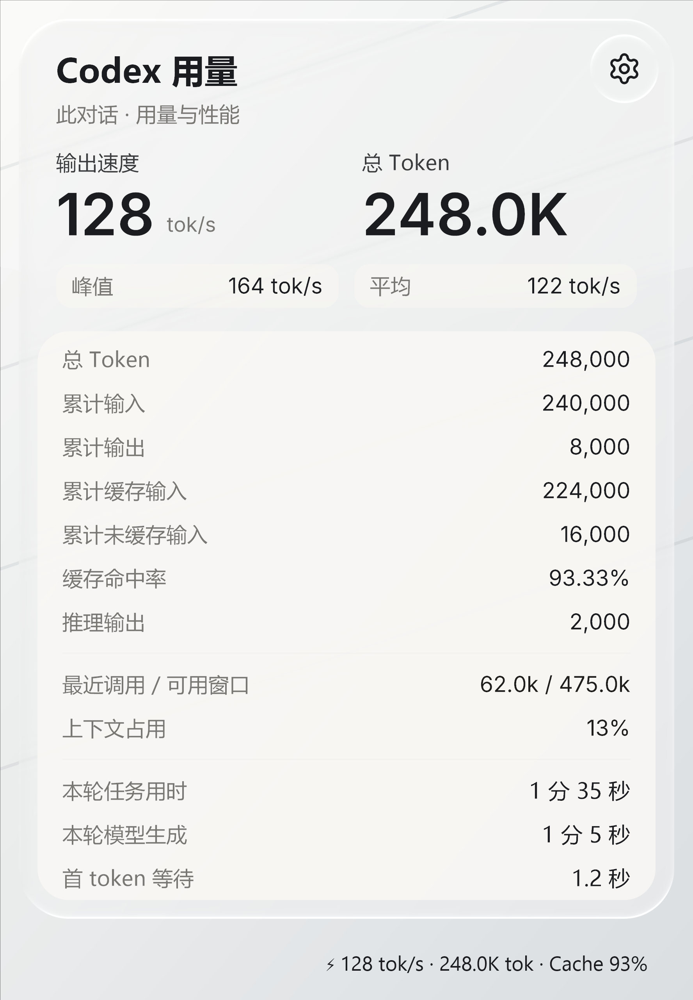
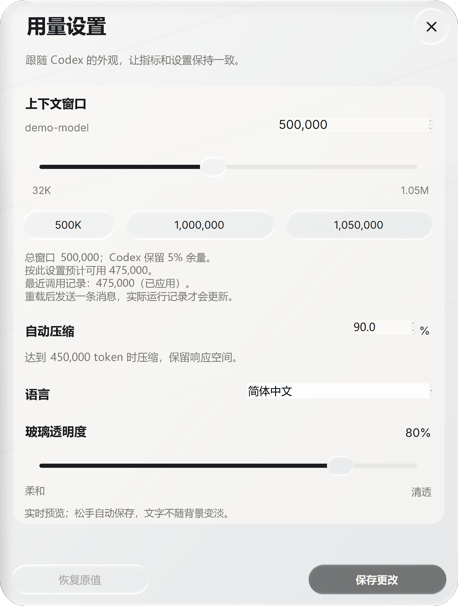
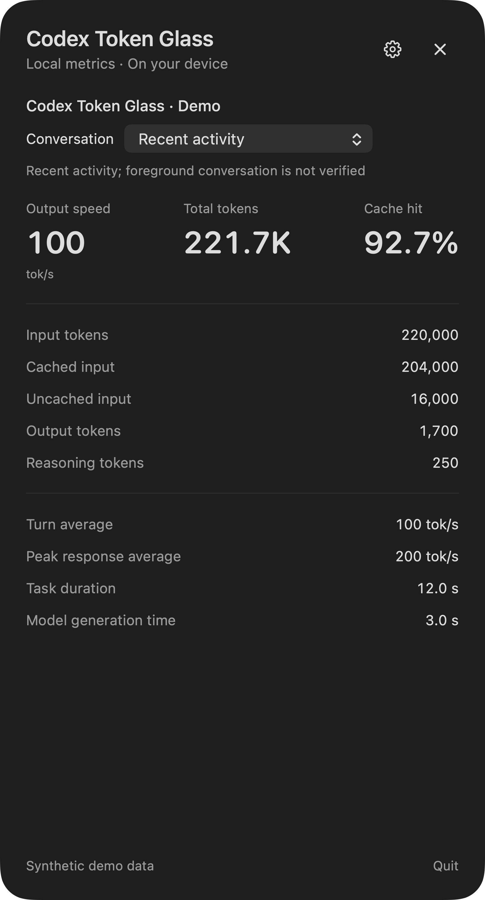
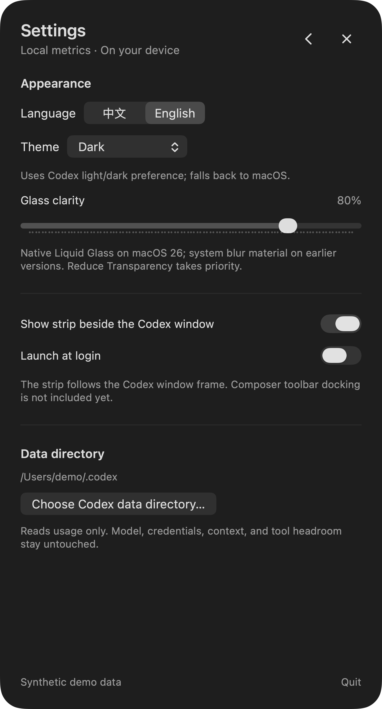

# Codex Token Glass

给 Windows 版 Codex 加一条贴附状态栏：token 用量、缓存命中率、模型输出吞吐，以及可交互的 Liquid Glass 详情和设置面板。

**这是独立的 Windows 桌面伴随程序。** 它贴附在官方 Codex 窗口上，不是 `codex plugin add` 安装的 MCP 插件，也不修改、注入或替换 Codex。

基于 [dongyue-19/codex-statusbar](https://github.com/dongyue-19/codex-statusbar) 修改，保留上游 MIT 许可及署名。图形材质使用 [LiquidGlass](https://github.com/shayann07/liquidglass)，不是 Apple 官方组件或原生 iOS API。

## 高清界面预览

[查看全部 39 张高清原图：中英 / 明暗 / 状态条 / 详情 / 设置 / 菜单](docs/SCREENSHOTS.md)

<table>
<tr><th>Windows 用量详情</th><th>Windows 设置</th></tr>
<tr><td><a href="https://raw.githubusercontent.com/weienjiang0308-cyber/codex-token-glass/main/assets/screenshots/windows/windows-details-light-zh.png"></a></td><td><a href="https://raw.githubusercontent.com/weienjiang0308-cyber/codex-token-glass/main/assets/screenshots/windows/windows-settings-light-zh.png"></a></td></tr>
<tr><th>macOS 预览：用量详情</th><th>macOS 预览：设置</th></tr>
<tr><td><a href="https://raw.githubusercontent.com/weienjiang0308-cyber/codex-token-glass/main/assets/screenshots/macos/macos-details-dark-en.png"></a></td><td><a href="https://raw.githubusercontent.com/weienjiang0308-cyber/codex-token-glass/main/assets/screenshots/macos/macos-settings-dark-en.png"></a></td></tr>
</table>

*全部使用合成数据与背景，未截取真实会话或桌面。Windows 设置原图 2208×2920；Mac 详情和设置原图 1640×3040。点击图片查看原始 PNG。Mac 界面属于[独立移植预览](https://github.com/weienjiang0308-cyber/codex-token-glass/pull/1)。*


## 功能

- 贴附到当前 Codex 对话，切换对话后跟随读取对应的本地记录。
- 输入、输出、缓存输入、未缓存输入、推理 token、累计总量与缓存命中率。
- 本轮平均生成吞吐、已记录响应峰值、任务总耗时、模型生成耗时。
- GPU 折射材质、展开与按压回弹，支持系统减少动态效果、减少透明度及高对比度设置。
- 中英切换、跟随 Codex 的明暗与自定义配色、可保存的玻璃清透度。
- 独立的每用户后台启动，避免监测器随 Codex 的执行进程树退出。
- 设置页可修改本地上下文与压缩阈值；**安装程序不自动改这些设置，更不会改 5% 缓冲**。

## 指标到底是不是真的？

不是所有数字都是“估计”。请分清两类：

| 指标 | 来源与含义 | 准确性边界 |
|---|---|---|
| 输入 / 输出 / 缓存 token | Codex 会话记录中的上游 usage 计数 | 读的是记录值，不按字符猜；受记录完整性与版本兼容性影响 |
| 缓存命中率 | `cached_input_tokens / input_tokens` | 从记录计数计算的比例，不是根据响应速度猜缓存 |
| 平均输出速度 | 本轮输出 token ÷ 合并后的模型生成时间窗 | 日志时间统计；不是服务端逐 token 瞬时测速 |
| 峰值响应速度 | 已完成、可计时响应中的最高响应均速 | 不是某一瞬间的峰值；不足 500ms 的时间窗不参与峰值 |
| 任务耗时 | 本轮开始到结束的墙钟时间 | 包含工具与等待；与模型生成时间是不同口径 |

输出速度包含 Codex 上报的推理输出，不仅是屏幕上可见的正文。工具执行、用户思考和排队时间不计入“模型生成时间”分母。重复/重叠的模型时间窗做区间合并，两个 usage 载体重复上报时不会把累计值相加。

日志通常在响应完成后更新，界面因此可能延迟；短响应、缺失时间戳、打开面板时只恢复到部分本轮历史，都会影响速度统计。不能把它当作服务端内部每秒解码轨迹或账单。

详见 [指标定义与跨产品口径](docs/METRICS.md)。

## 最省事：把下面这段发给你的 AI

完整可复制版本也保存在 [AI-INSTALL-PROMPT.zh-CN.txt](AI-INSTALL-PROMPT.zh-CN.txt)。

```text
请在我的 Windows 10/11 x64 电脑上安装并配置这个开源 Codex 状态栏：
https://github.com/weienjiang0308-cyber/codex-token-glass

请先阅读 README.md、install.ps1 和 docs/METRICS.md，确认这是 Windows 桌面伴随程序，
不要运行 codex plugin add，也不要把它当成浏览器扩展。

直接完成安装和验证，不要只给我教程。优先下载仓库 Releases 中的正式安装包，
校验 SHA256 后运行 install.ps1，界面选择中文、保留 English 切换，
跟随 Codex 配色，玻璃清透度设为 80，配置独立的每用户后台启动。
不要修改我的模型、API 地址、密钥、Codex 上下文窗口、自动压缩阈值或 5% 缓冲，
不要复制作者的本机配置，也不要上传我的会话日志。

如果没有可用 Release，则克隆源码后运行 install.ps1 -FromSource；
缺少 .NET 10 SDK 时，脚本可从微软下载并校验临时专用 SDK，不改系统 SDK。
已有本程序时使用正常退出/本用户控制通道更新，不强制结束 Codex 或其他工作任务。

完成后检查启动任务、进程和安装路径；如果 Codex 正在运行，打开详情和设置页，
核对当前对话的 token/缓存字段并给我一张截图。
速度必须说明为日志时间统计，不能声称是服务端瞬时实测。
系统策略或权限确实阻止某一步时，说明具体阻碍和需要我做的最少操作。
```

## 手动安装

要求：Windows 10/11 **x64**，已安装并至少运行过 Codex。OpenGL 显卡加速推荐；不可用时会使用兼容路径，动效性能可能降低。不需要 API key，不需要系统安装 .NET 运行时。

1. 从 [Releases](https://github.com/weienjiang0308-cyber/codex-token-glass/releases) 下载并校验 `CodexTokenGlass-win-x64.zip`。
2. 克隆/下载本仓库，在 PowerShell 中运行：

```powershell
.\install.ps1 -Language zh -GlassTransparency 80
```

本地已有安装包时：

```powershell
.\install.ps1 -PackagePath C:\Downloads\CodexTokenGlass-win-x64.zip -Language zh -GlassTransparency 80
```

从源码安装并自动准备专用构建 SDK：

```powershell
.\install.ps1 -FromSource -Language zh -GlassTransparency 80
```

查看计划、不做安装：

```powershell
.\install.ps1 -WhatIf
```

脚本策略若阻止运行，请遵循你电脑的策略，不要全局关闭安全策略。直接运行下载包里的 `CodexStatusbar.exe` 也可临时使用；要可靠地跨 Codex 重启运行，建议使用安装脚本配置后台启动。

## 安装与配置位置

- 程序：`%LOCALAPPDATA%\Programs\CodexTokenGlass\`
- 后台任务：`Codex Token Glass Watcher`，仅当前用户登录时运行，不需要管理员权限。
- 外观偏好：`$CODEX_HOME\codex-token-glass\ui.json`；未设置 `CODEX_HOME` 时位于 `~\.codex\codex-token-glass\ui.json`。
- 旧版 `%LOCALAPPDATA%\CodexStatusbar\ui.json` 在首次读取时可作为兼容来源。

安装器只写本程序文件、外观偏好及当前用户的启动项。只有你在设置页主动保存上下文配置时，才会修改 Codex 的 `model_context_window` 与 `model_auto_compact_token_limit`，且会保留原值备份。

本地配置不能创造服务端没有的能力，实际窗口还受模型与客户端约束。安装器不会帮你伪造模型能力表或自动提高窗口。

## 隐私和兼容性

- 通过本地 Codex IPC 跟随会话；IPC 不可用时，最近活动会话回退可能出现短暂识别偏差。
- 只读 `state_5.sqlite` 与会话 JSONL，不需要也不读取 `auth.json`。
- 为显示折射，打开面板时会把面板后方画面采样到**本机内存**。不上传，也不把该采样作为日志保存在磁盘；关闭重开会刷新背景。
- 当前画面来源是打开时的快照，不声称是 Apple 原生材质或持续实时桌面捕获。
- Codex 的本地记录与 IPC 属于可能变化的实现细节；本项目会尽力兼容，不能保证每次 Codex 更新都无需适配。

## 开发

```powershell
dotnet --list-sdks  # .NET 10 SDK
.\build.ps1
```

构建产物是自包含单文件 `dist\CodexStatusbar.exe`。完整验证：

```powershell
dist\CodexStatusbar.exe --self-test fixtures
```

不会为测试启动模型任务或消耗额外模型请求。文档中的演示素材必须用合成数据，禁止提交真实会话、数据库、账号配置、密钥或桌面截图。

## 致谢与许可

[MIT License](LICENSE)。这不是 OpenAI 官方项目。

- 上游：[dongyue-19/codex-statusbar](https://github.com/dongyue-19/codex-statusbar)
- 更早的基础：[soleillevant0125/codex-token-overlay](https://github.com/soleillevant0125/codex-token-overlay)
- Liquid Glass 渲染：[shayann07/liquidglass](https://github.com/shayann07/liquidglass)，Apache-2.0
- SkiaSharp、Inter、Lucide 许可见 [THIRD-PARTY-NOTICES.md](THIRD-PARTY-NOTICES.md) 与对应 assets 子目录。
