# 高清界面图库

**39 张无损 PNG，按 4 倍像素密度重新渲染。** 点击图片或“打开原图”查看完整分辨率；GitHub 页面内的缩略展示不代表原图像素。

全部使用合成 token、会话、模型配置与背景；Mac 目录固定为虚构的 `/Users/demo/.codex`。没有真实聊天、账号、密钥、用户名或桌面截图。

Windows 使用实际状态栏、详情与设置控件渲染；菜单部分使用原生 WinForms 菜单项做纵向完整清单，避免受屏幕高度限制漏掉底部菜单。Mac 使用原生 SwiftUI/AppKit，将高清文字层和原生控件层按原始像素合成；展示的是 [macOS 移植预览](https://github.com/weienjiang0308-cyber/codex-token-glass/pull/1)，不是已经公证的正式 Mac Release。

[完整图片清单、像素尺寸及 SHA256](../assets/screenshots/manifest.json)

## Windows

### 简体中文

| 界面 | 浅色 | 深色 |
|---|---|---|
| 状态条 / 浮条 |  1840 × 336 · [打开原图](https://raw.githubusercontent.com/weienjiang0308-cyber/codex-token-glass/main/assets/screenshots/windows/windows-strip-light-zh.png) | [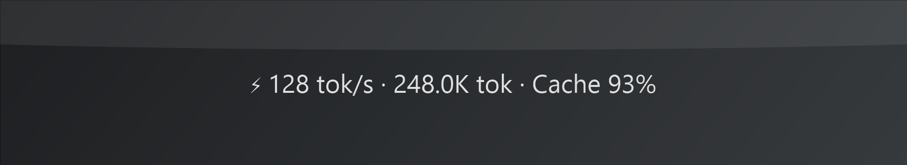](https://raw.githubusercontent.com/weienjiang0308-cyber/codex-token-glass/main/assets/screenshots/windows/windows-strip-dark-zh.png) 1840 × 336 · [打开原图](https://raw.githubusercontent.com/weienjiang0308-cyber/codex-token-glass/main/assets/screenshots/windows/windows-strip-dark-zh.png) |
| 用量详情 | [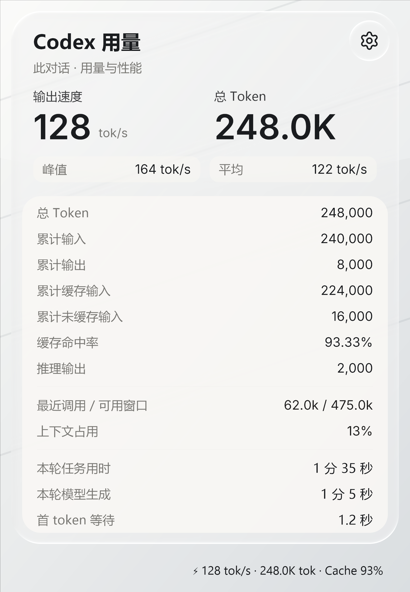](https://raw.githubusercontent.com/weienjiang0308-cyber/codex-token-glass/main/assets/screenshots/windows/windows-details-light-zh.png) 1776 × 2560 · [打开原图](https://raw.githubusercontent.com/weienjiang0308-cyber/codex-token-glass/main/assets/screenshots/windows/windows-details-light-zh.png) | [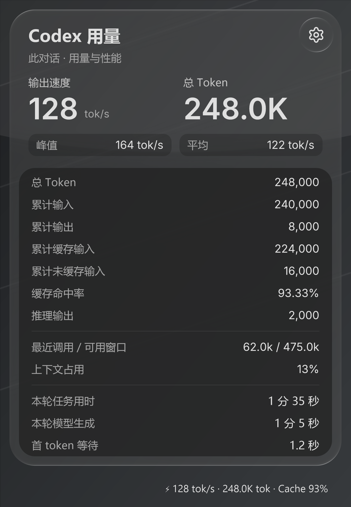](https://raw.githubusercontent.com/weienjiang0308-cyber/codex-token-glass/main/assets/screenshots/windows/windows-details-dark-zh.png) 1776 × 2560 · [打开原图](https://raw.githubusercontent.com/weienjiang0308-cyber/codex-token-glass/main/assets/screenshots/windows/windows-details-dark-zh.png) |
| 设置 | [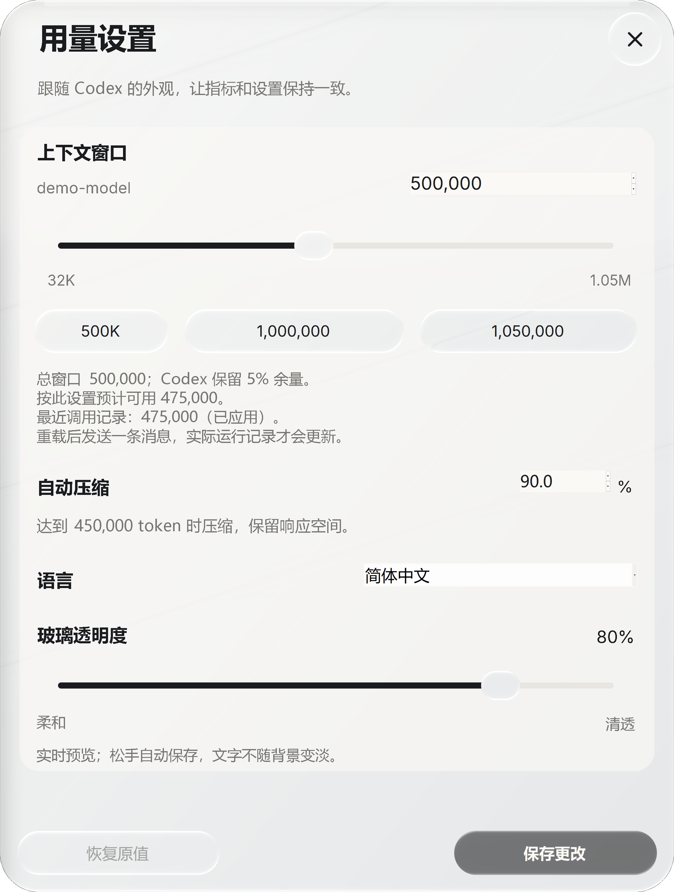](https://raw.githubusercontent.com/weienjiang0308-cyber/codex-token-glass/main/assets/screenshots/windows/windows-settings-light-zh.png) 2208 × 2920 · [打开原图](https://raw.githubusercontent.com/weienjiang0308-cyber/codex-token-glass/main/assets/screenshots/windows/windows-settings-light-zh.png) | [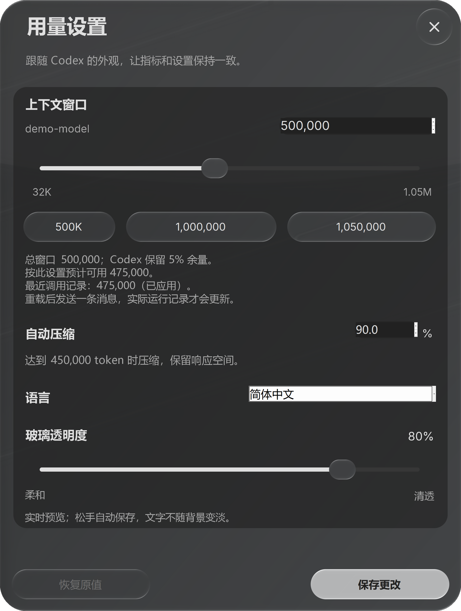](https://raw.githubusercontent.com/weienjiang0308-cyber/codex-token-glass/main/assets/screenshots/windows/windows-settings-dark-zh.png) 2208 × 2920 · [打开原图](https://raw.githubusercontent.com/weienjiang0308-cyber/codex-token-glass/main/assets/screenshots/windows/windows-settings-dark-zh.png) |

### English

| 界面 | 浅色 | 深色 |
|---|---|---|
| 状态条 / 浮条 |  1840 × 336 · [打开原图](https://raw.githubusercontent.com/weienjiang0308-cyber/codex-token-glass/main/assets/screenshots/windows/windows-strip-light-en.png) |  1840 × 336 · [打开原图](https://raw.githubusercontent.com/weienjiang0308-cyber/codex-token-glass/main/assets/screenshots/windows/windows-strip-dark-en.png) |
| 用量详情 | [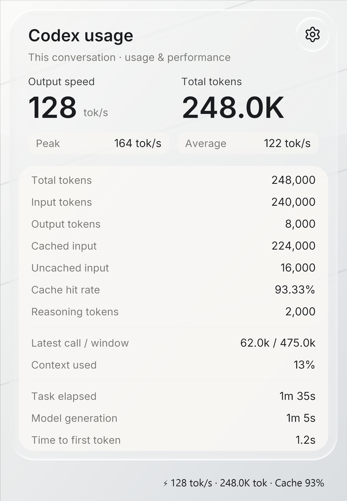](https://raw.githubusercontent.com/weienjiang0308-cyber/codex-token-glass/main/assets/screenshots/windows/windows-details-light-en.png) 1776 × 2560 · [打开原图](https://raw.githubusercontent.com/weienjiang0308-cyber/codex-token-glass/main/assets/screenshots/windows/windows-details-light-en.png) | [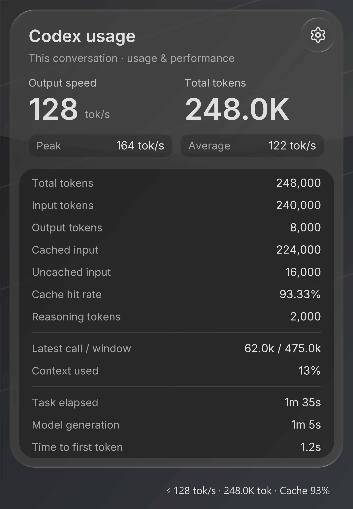](https://raw.githubusercontent.com/weienjiang0308-cyber/codex-token-glass/main/assets/screenshots/windows/windows-details-dark-en.png) 1776 × 2560 · [打开原图](https://raw.githubusercontent.com/weienjiang0308-cyber/codex-token-glass/main/assets/screenshots/windows/windows-details-dark-en.png) |
| 设置 | [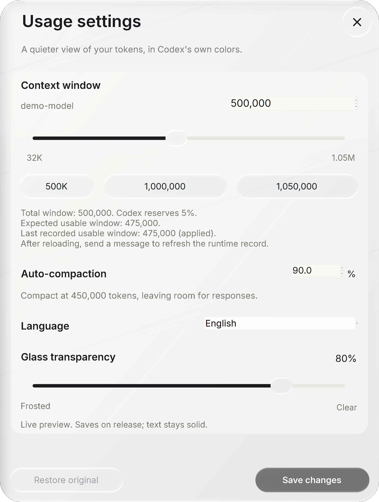](https://raw.githubusercontent.com/weienjiang0308-cyber/codex-token-glass/main/assets/screenshots/windows/windows-settings-light-en.png) 2208 × 2920 · [打开原图](https://raw.githubusercontent.com/weienjiang0308-cyber/codex-token-glass/main/assets/screenshots/windows/windows-settings-light-en.png) | [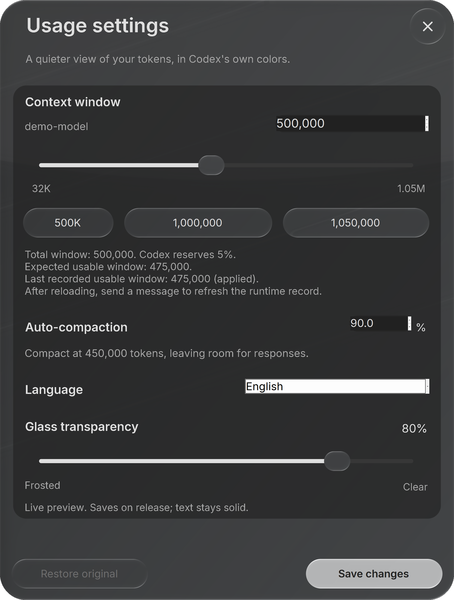](https://raw.githubusercontent.com/weienjiang0308-cyber/codex-token-glass/main/assets/screenshots/windows/windows-settings-dark-en.png) 2208 × 2920 · [打开原图](https://raw.githubusercontent.com/weienjiang0308-cyber/codex-token-glass/main/assets/screenshots/windows/windows-settings-dark-en.png) |

### 其他状态

| 界面 | 浅色 | 深色 |
|---|---|---|
| 等待数据 | [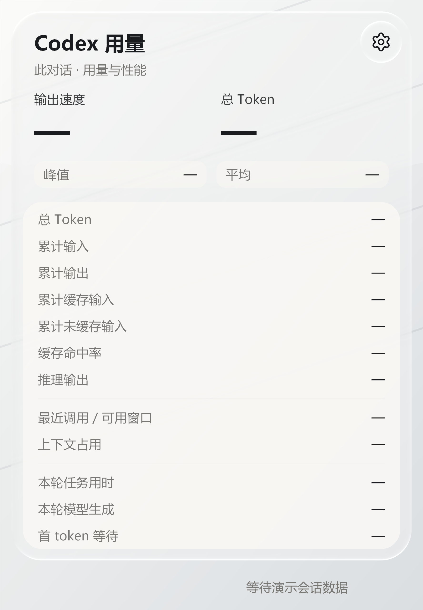](https://raw.githubusercontent.com/weienjiang0308-cyber/codex-token-glass/main/assets/screenshots/windows/windows-waiting-light-zh.png) 1776 × 2560 · [打开原图](https://raw.githubusercontent.com/weienjiang0308-cyber/codex-token-glass/main/assets/screenshots/windows/windows-waiting-light-zh.png) | [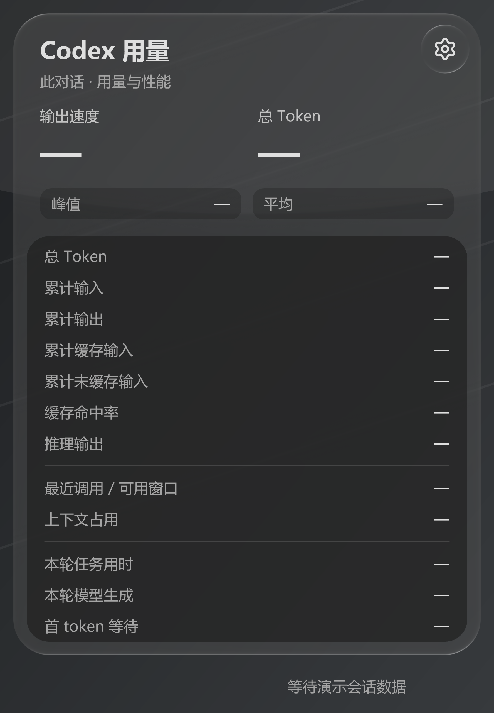](https://raw.githubusercontent.com/weienjiang0308-cyber/codex-token-glass/main/assets/screenshots/windows/windows-waiting-dark-zh.png) 1776 × 2560 · [打开原图](https://raw.githubusercontent.com/weienjiang0308-cyber/codex-token-glass/main/assets/screenshots/windows/windows-waiting-dark-zh.png) |
| 位置调整 | [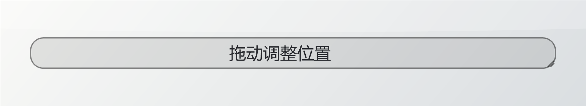](https://raw.githubusercontent.com/weienjiang0308-cyber/codex-token-glass/main/assets/screenshots/windows/windows-position-edit-light-zh.png) 1840 × 336 · [打开原图](https://raw.githubusercontent.com/weienjiang0308-cyber/codex-token-glass/main/assets/screenshots/windows/windows-position-edit-light-zh.png) | [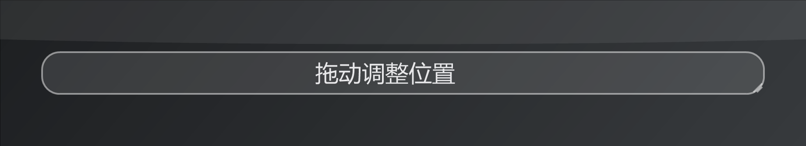](https://raw.githubusercontent.com/weienjiang0308-cyber/codex-token-glass/main/assets/screenshots/windows/windows-position-edit-dark-zh.png) 1840 × 336 · [打开原图](https://raw.githubusercontent.com/weienjiang0308-cyber/codex-token-glass/main/assets/screenshots/windows/windows-position-edit-dark-zh.png) |

## macOS 预览

### 简体中文

| 界面 | 浅色 | 深色 |
|---|---|---|
| 状态条 / 浮条 | [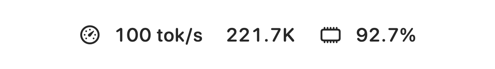](https://raw.githubusercontent.com/weienjiang0308-cyber/codex-token-glass/main/assets/screenshots/macos/macos-strip-light-zh.png) 1240 × 176 · [打开原图](https://raw.githubusercontent.com/weienjiang0308-cyber/codex-token-glass/main/assets/screenshots/macos/macos-strip-light-zh.png) |  1240 × 176 · [打开原图](https://raw.githubusercontent.com/weienjiang0308-cyber/codex-token-glass/main/assets/screenshots/macos/macos-strip-dark-zh.png) |
| 用量详情 | [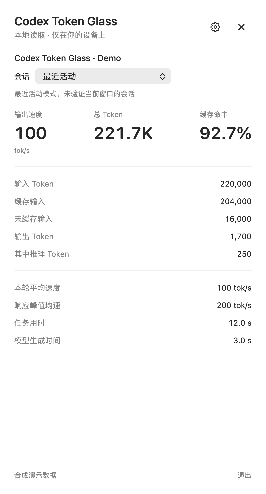](https://raw.githubusercontent.com/weienjiang0308-cyber/codex-token-glass/main/assets/screenshots/macos/macos-details-light-zh.png) 1640 × 3040 · [打开原图](https://raw.githubusercontent.com/weienjiang0308-cyber/codex-token-glass/main/assets/screenshots/macos/macos-details-light-zh.png) | [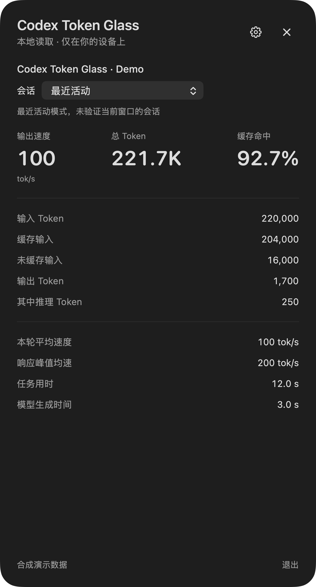](https://raw.githubusercontent.com/weienjiang0308-cyber/codex-token-glass/main/assets/screenshots/macos/macos-details-dark-zh.png) 1640 × 3040 · [打开原图](https://raw.githubusercontent.com/weienjiang0308-cyber/codex-token-glass/main/assets/screenshots/macos/macos-details-dark-zh.png) |
| 设置 | [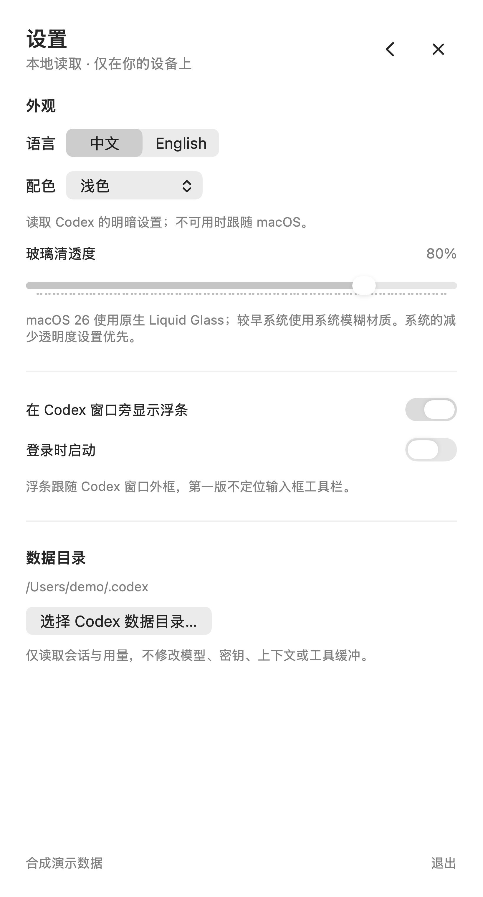](https://raw.githubusercontent.com/weienjiang0308-cyber/codex-token-glass/main/assets/screenshots/macos/macos-settings-light-zh.png) 1640 × 3040 · [打开原图](https://raw.githubusercontent.com/weienjiang0308-cyber/codex-token-glass/main/assets/screenshots/macos/macos-settings-light-zh.png) | [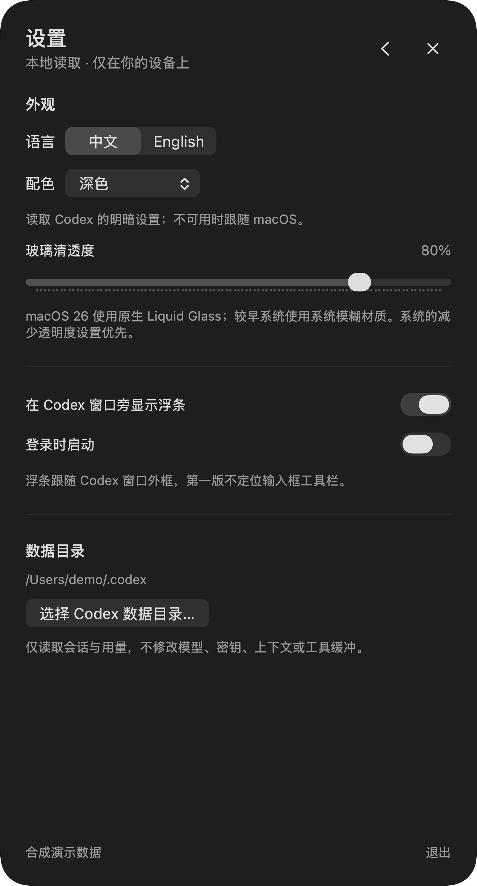](https://raw.githubusercontent.com/weienjiang0308-cyber/codex-token-glass/main/assets/screenshots/macos/macos-settings-dark-zh.png) 1640 × 3040 · [打开原图](https://raw.githubusercontent.com/weienjiang0308-cyber/codex-token-glass/main/assets/screenshots/macos/macos-settings-dark-zh.png) |

### English

| 界面 | 浅色 | 深色 |
|---|---|---|
| 状态条 / 浮条 |  1240 × 176 · [打开原图](https://raw.githubusercontent.com/weienjiang0308-cyber/codex-token-glass/main/assets/screenshots/macos/macos-strip-light-en.png) |  1240 × 176 · [打开原图](https://raw.githubusercontent.com/weienjiang0308-cyber/codex-token-glass/main/assets/screenshots/macos/macos-strip-dark-en.png) |
| 用量详情 | [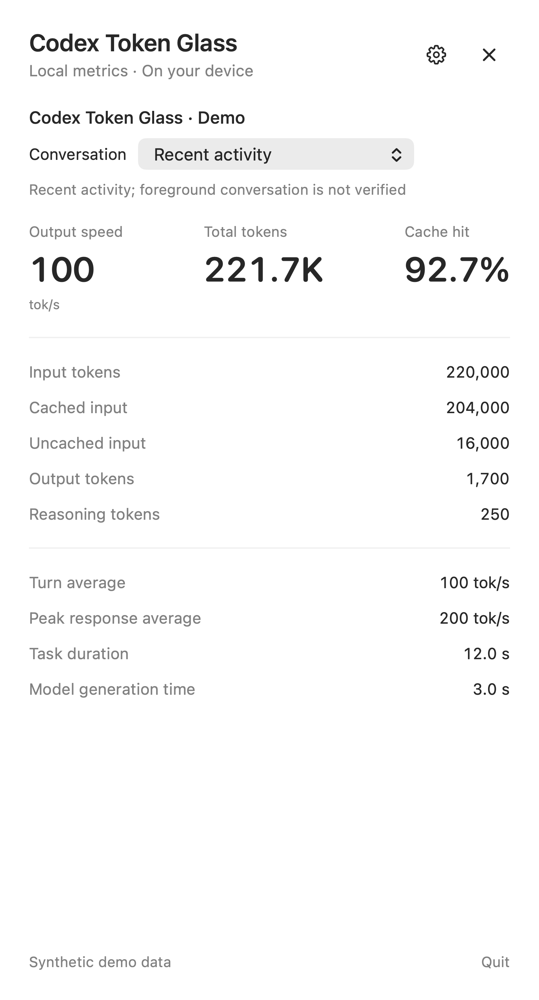](https://raw.githubusercontent.com/weienjiang0308-cyber/codex-token-glass/main/assets/screenshots/macos/macos-details-light-en.png) 1640 × 3040 · [打开原图](https://raw.githubusercontent.com/weienjiang0308-cyber/codex-token-glass/main/assets/screenshots/macos/macos-details-light-en.png) | [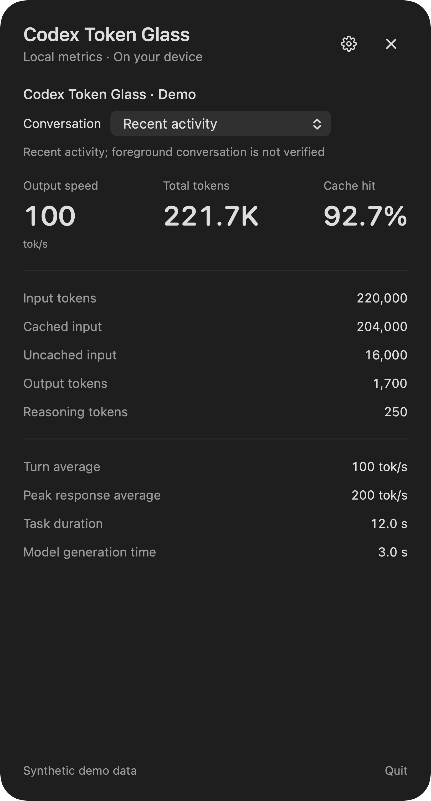](https://raw.githubusercontent.com/weienjiang0308-cyber/codex-token-glass/main/assets/screenshots/macos/macos-details-dark-en.png) 1640 × 3040 · [打开原图](https://raw.githubusercontent.com/weienjiang0308-cyber/codex-token-glass/main/assets/screenshots/macos/macos-details-dark-en.png) |
| 设置 | [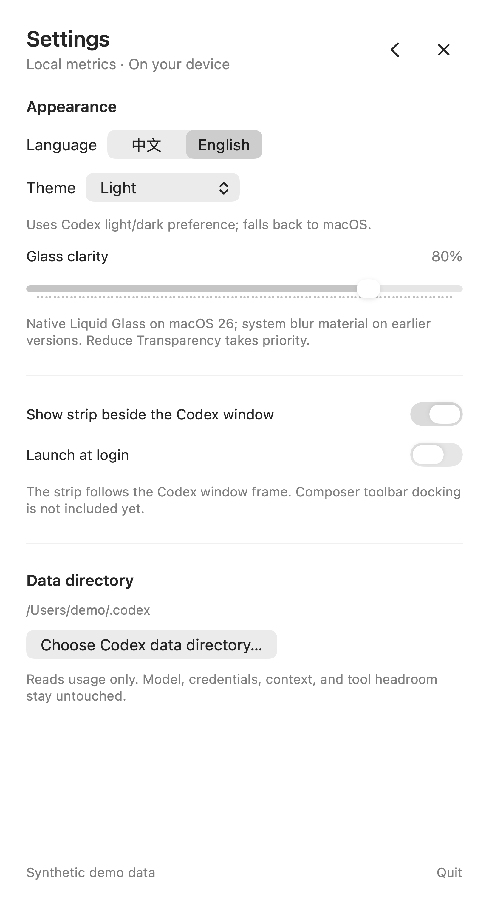](https://raw.githubusercontent.com/weienjiang0308-cyber/codex-token-glass/main/assets/screenshots/macos/macos-settings-light-en.png) 1640 × 3040 · [打开原图](https://raw.githubusercontent.com/weienjiang0308-cyber/codex-token-glass/main/assets/screenshots/macos/macos-settings-light-en.png) | [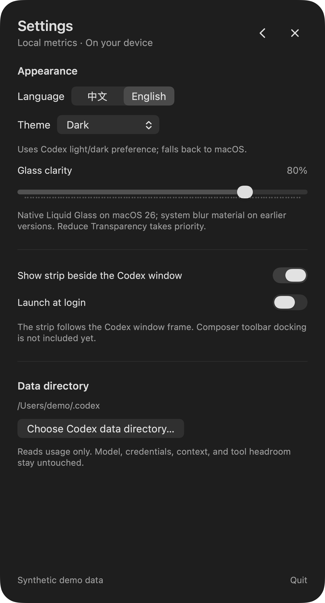](https://raw.githubusercontent.com/weienjiang0308-cyber/codex-token-glass/main/assets/screenshots/macos/macos-settings-dark-en.png) 1640 × 3040 · [打开原图](https://raw.githubusercontent.com/weienjiang0308-cyber/codex-token-glass/main/assets/screenshots/macos/macos-settings-dark-en.png) |

### 其他状态

| 界面 | 浅色 | 深色 |
|---|---|---|
| 等待数据 | [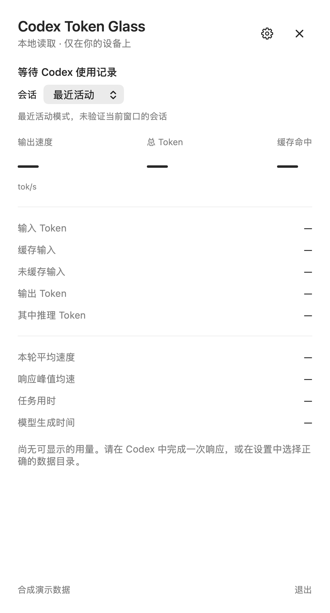](https://raw.githubusercontent.com/weienjiang0308-cyber/codex-token-glass/main/assets/screenshots/macos/macos-waiting-light-zh.png) 1640 × 3040 · [打开原图](https://raw.githubusercontent.com/weienjiang0308-cyber/codex-token-glass/main/assets/screenshots/macos/macos-waiting-light-zh.png) | [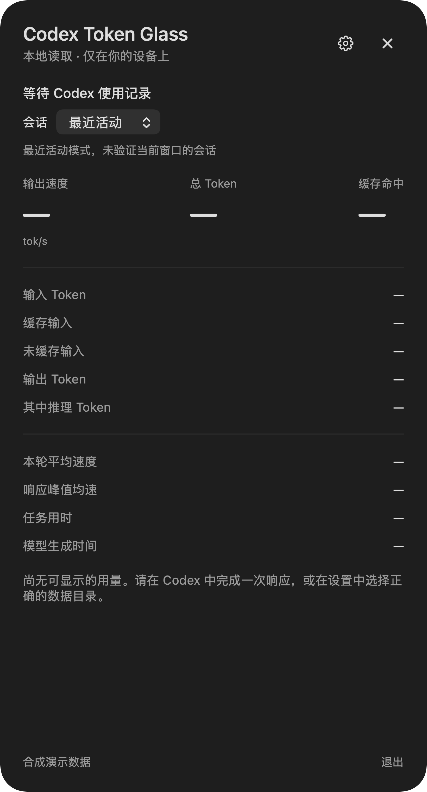](https://raw.githubusercontent.com/weienjiang0308-cyber/codex-token-glass/main/assets/screenshots/macos/macos-waiting-dark-zh.png) 1640 × 3040 · [打开原图](https://raw.githubusercontent.com/weienjiang0308-cyber/codex-token-glass/main/assets/screenshots/macos/macos-waiting-dark-zh.png) |

## Windows 托盘菜单清单

静态演示状态；菜单项采用纵向展开布局，所有入口均保留，不包含真实会话和窗口位置。现有托盘菜单沿用程序中的中英混合标签。

完整主菜单

[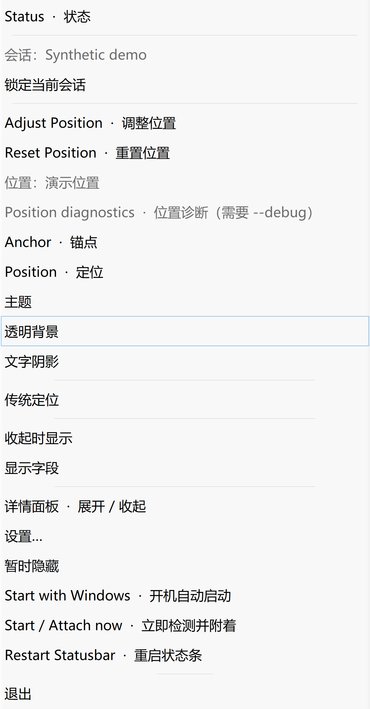](https://raw.githubusercontent.com/weienjiang0308-cyber/codex-token-glass/main/assets/screenshots/windows/windows-menu-root.png)

运行状态

[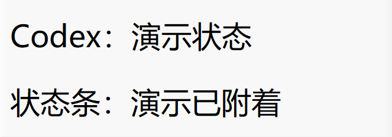](https://raw.githubusercontent.com/weienjiang0308-cyber/codex-token-glass/main/assets/screenshots/windows/windows-menu-status.png)

锚点

[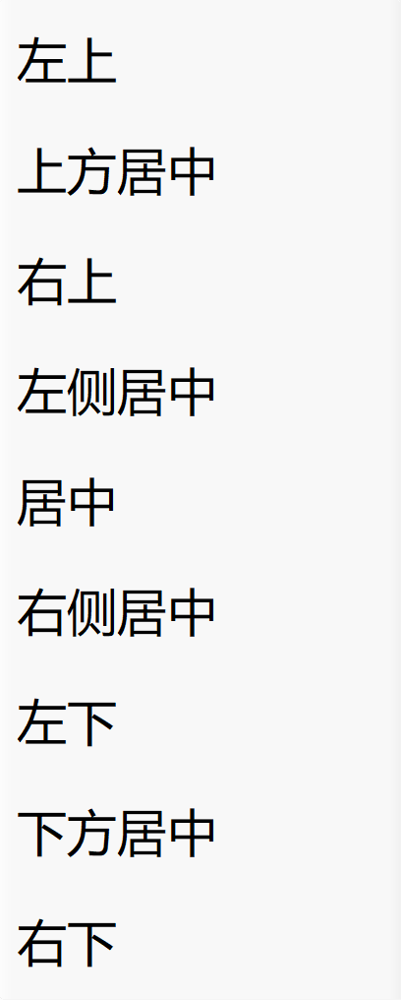](https://raw.githubusercontent.com/weienjiang0308-cyber/codex-token-glass/main/assets/screenshots/windows/windows-menu-anchor.png)

定位方式

[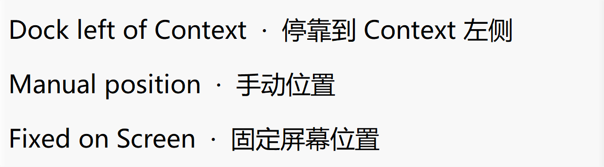](https://raw.githubusercontent.com/weienjiang0308-cyber/codex-token-glass/main/assets/screenshots/windows/windows-menu-position-mode.png)

主题

[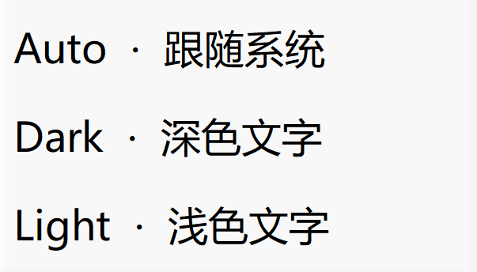](https://raw.githubusercontent.com/weienjiang0308-cyber/codex-token-glass/main/assets/screenshots/windows/windows-menu-theme.png)

传统定位

[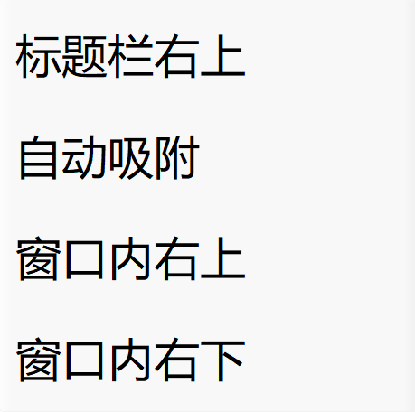](https://raw.githubusercontent.com/weienjiang0308-cyber/codex-token-glass/main/assets/screenshots/windows/windows-menu-traditional-position.png)

左侧指标

右侧指标

[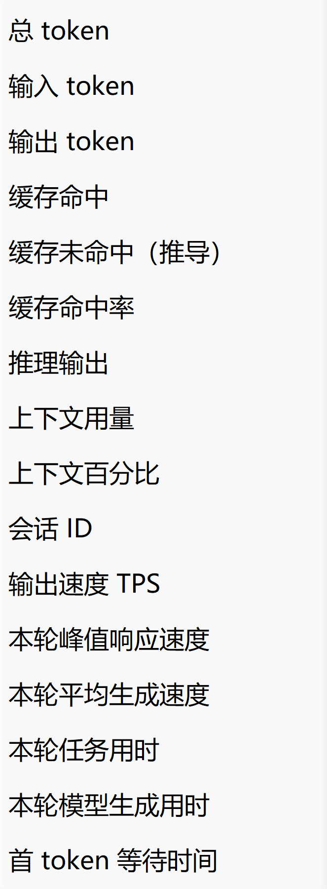](https://raw.githubusercontent.com/weienjiang0308-cyber/codex-token-glass/main/assets/screenshots/windows/windows-menu-secondary-metric.png)

显示字段

